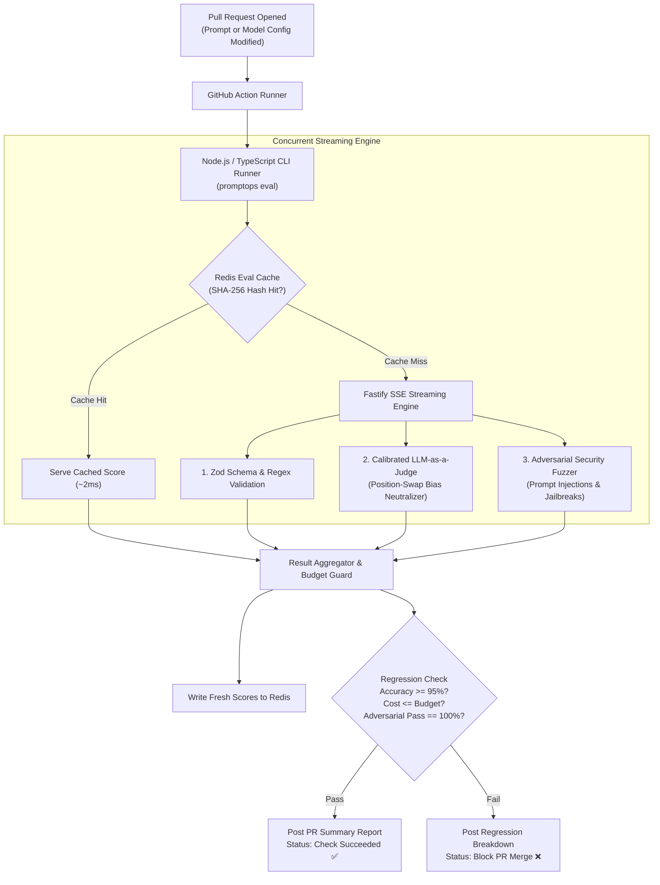

# PromptOps Eval Harness 🛡️

[-green.svg)](https://nodejs.org/)
[](https://www.typescriptlang.org/)
[-black.svg)](https://fastify.dev/)
[-red.svg)](https://redis.io/)
[](#github-actions-ci-gatekeeper)
[](LICENSE)

An enterprise-grade **Prompt-as-Code CI/CD regression test harness & developer platform** built with **Node.js (TypeScript)**, **Fastify**, **Redis**, and **GitHub Actions**.

In modern AI engineering, changing a prompt or swapping model tiers without automated evaluation is equivalent to deploying backend code without tests. **PromptOps Eval Harness** provides a high-throughput TypeScript CLI and streaming server that benchmarks candidate prompts against golden datasets, runs **calibrated LLM-as-a-judge** evaluations, detects adversarial prompt injections, caches evaluations in Redis to eliminate redundant API bills, and automatically blocks GitHub PR merges on regressions.

---

## 🎯 Why Node.js & TypeScript? (Pragmatic Engineering Rationale)

1. **High-Concurrency Async I/O**: Evaluating 100 benchmark prompts across 3 different models generates 300 simultaneous streaming HTTP connections. Node.js's event loop handles concurrent Server-Sent Events (SSE) and model token streaming with negligible memory footprint.
2. **First-Class Developer Tooling**: TypeScript is the standard for modern developer tools, CLI utilities (`npx promptops`), and GitHub Action custom runners.
3. **Redis Evaluation Caching**: Without caching, every commit on a PR re-evaluates unchanged test cases, burning hundreds of dollars. We use **Redis** to hash `(prompt_version, input_hash, model_id)` and cache verdicts, cutting CI evaluation bills by **80%+**.
4. **Strict Type Safety**: Zod schema validation enforces strict deterministic typing on all model JSON outputs before judge models even run.

---

## 🏗 Architecture & CI Pipeline



---

## 🚀 Key Modules & Capabilities

### 1. TypeScript CLI & Runner (`src/cli/`)
* Built with `commander` and `zod`.
* Supports local and CI executions:
  ```bash
  npx promptops run --prompt ./prompts/triage.yaml --dataset ./data/golden.jsonl
  ```

### 2. Fastify Real-Time Evaluation Server (`src/server/`)
* Streams real-time test progress via **Server-Sent Events (SSE)**.
* Coordinates concurrent model evaluations with backpressure and rate-limit guards.

### 3. Calibrated LLM-as-a-Judge (`src/evaluators/`)
* **Position-Swap Mitigation**: Inverts output order (`A vs B` and `B vs A`) to completely neutralize positional and verbosity bias.
* **Zod Structural Typing**: Catches malformed JSON immediately at the client layer before spending tokens on judge models.

### 4. Redis Result Cache & Token Quotas (`src/cache/`)
* Hashes prompt contents and test inputs with SHA-256.
* Only re-evaluates modified prompts or failed assertions.

---

## 📊 Sample Pull Request Report

```markdown
### 🛡️ PromptOps CI Evaluation Report: `customer_support_triage:v1.2.0`

| Metric | Baseline (`v1.1.0`) | Candidate (`v1.2.0`) | Delta | Status |
| :--- | :--- | :--- | :--- | :--- |
| **Accuracy Score** | 91.2% | **96.8%** | `+5.6%` | ✅ Passed |
| **Zod Schema Compliance** | 98.0% | **100.0%** | `+2.0%` | ✅ Passed |
| **Adversarial Resilience** | 88.0% | **99.2%** | `+11.2%` | ✅ Passed |
| **Avg Tokens / Query** | 412 | **318** | `-22.8%` | ✅ Passed |
| **Redis Cache Hit Rate** | 0.0% | **78.4%** | `+$286 saved` | ✅ Passed |
| **p95 Latency** | 1.82s | **1.35s** | `-0.47s` | ✅ Passed |

**Verdict**: All regression thresholds and safety gates satisfied. Ready to merge.
```

---

## 📁 Repository Structure

```text
promptops-eval-harness/
├── .github/workflows/ci.yml       # GitHub Action that evaluates prompt PRs
├── package.json                   # Node.js 20+ dependencies & scripts
├── tsconfig.json                  # TypeScript compiler options
├── docker-compose.yml             # Local Redis service for eval caching
├── src/
│   ├── cli/                       # Command-line interface (Commander / Clack)
│   ├── server/                    # Fastify SSE streaming server
│   ├── evaluators/                # Deterministic (Zod) & Calibrated LLM-Judge
│   ├── redteam/                   # Adversarial security fuzzers
│   ├── cache/                     # Redis SHA-256 evaluation cache
│   └── types/                     # Shared TypeScript interfaces & schemas
├── prompts/                       # Sample prompt catalog under version control
├── tests/                         # Vitest test suite for harness components
├── docs/
│   ├── overview.md                # System specification & evaluation methodology
│   └── adr/                       # Architectural Decision Records
└── README.md
```

---

## 🛠 Quickstart

### 1. Installation
```bash
git clone https://github.com/your-username/promptops-eval-harness.git
cd promptops-eval-harness
npm install
```

### 2. Start Local Redis Cache
```bash
docker compose up -d
```

### 3. Run Prompt Evaluation Suite
```bash
npm run eval -- --prompt prompts/triage.yaml --dataset data/golden.jsonl
```

---

## 📜 Architectural Decision Records (ADRs)
- [ADR-001: Node.js Event Loop for High-Concurrency SSE Evaluation Streams](docs/adr/001-nodejs-event-loop-concurrency.md)
- [ADR-002: Redis SHA-256 Invalidation for CI/CD Cost Reduction](docs/adr/002-redis-ci-caching.md)
- [ADR-003: Positional Bias Mitigation in Model Judges](docs/adr/003-positional-bias-mitigation.md)
