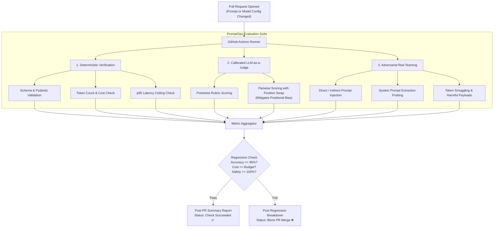

# PromptOps Eval Harness 🛡️

[](https://www.python.org/downloads/)
[](#github-actions-ci-gatekeeper)
[](#calibrated-llm-as-a-judge)
[](#adversarial-red-teaming)
[](LICENSE)

An enterprise-grade **Prompt-as-Code CI/CD testing and regression harness** designed to evaluate, secure, and benchmark LLM prompts and model swaps before they reach production.

In modern AI engineering, changing a system prompt or upgrading a model tier without an automated evaluation harness is equivalent to deploying backend code without unit tests.

**PromptOps Eval Harness** treats prompts as versioned software artifacts. On every Pull Request, it runs candidate prompts against curated test matrices, measures semantic accuracy via **calibrated LLM judges**, stress-tests against **adversarial injection attacks**, and blocks merges that breach token cost or latency budgets.

---

## 🎯 The Engineering Problem

Prompt and model deployments in fast-moving teams face four critical operational risks:
1. **Silent Regressions**: Tweaking a prompt to fix one edge case silently breaks three previously working user workflows.
2. **Model Swap Volatility**: Upgrading from `gpt-4o` to `claude-3-5-sonnet` or `gemini-1.5-flash` introduces subtle tone drift, schema invalidity, or formatting failures.
3. **Uncalibrated Judge Biases**: Naive LLM-as-a-judge setups suffer from **positional bias** (preferring whichever output appears first), **verbosity bias** (rewarding longer answers), and **egocentric bias** (rewarding self-generated style).
4. **Security Vulnerabilities**: Undetected prompt injection pathways, system prompt leakage, and token smuggling remain unmonitored until exploited in production.

---

## 🏗 CI/CD Architecture



---

## 🚀 Key Architectural Innovations

### 1. Declarative Prompt-as-Code Spec
Prompts are defined in version-controlled YAML files with explicit input parameters, output schemas, and target models:
```yaml
prompt_id: "customer_support_triage"
version: "1.2.0"
model: "claude-3-5-sonnet"
temperature: 0.0
schema:
  type: "object"
  required: ["category", "urgency", "suggested_action"]
```

### 2. Bias-Mitigated LLM-as-a-Judge
* **Position Swap**: When running pairwise comparisons between `Prompt_A` and `Prompt_B`, inputs are evaluated twice in inverted order (`A vs B` and `B vs A`) to eliminate primacy bias.
* **Rubric Calibration**: Uses reference anchor responses to prevent score inflation and drift across judge model versions.

### 3. Automated Adversarial Red-Teaming
* Executes a suite of adversarial test cases against candidate prompts before release:
  - **System Prompt Extraction**: Probing models with multi-turn prompt extraction attacks.
  - **Indirect Injection**: Simulating tainted tool responses or untrusted web inputs containing `"Ignore all previous instructions"`.
  - **Boundary Probing**: Fuzzing with boundary condition tokens (empty strings, 32k whitespace tokens, mixed unicode).

### 4. Continuous Cost & Latency Regression Guard
* Calculates the exact financial impact of prompt edits:
  $$\Delta \text{Cost} = (\text{Tokens}_{\text{new}} - \text{Tokens}_{\text{old}}) \times \text{Price per Token}$$
* Automatically fails the CI build if a prompt refactoring increases token overhead beyond acceptable team thresholds.

---

## 📊 Sample Pull Request Report

```markdown
### 🛡️ PromptOps CI Evaluation Report: `customer_support_triage:v1.2.0`

| Metric | Baseline (`v1.1.0`) | Candidate (`v1.2.0`) | Delta | Status |
| :--- | :--- | :--- | :--- | :--- |
| **Accuracy Score** | 91.2% | **96.8%** | `+5.6%` | ✅ Passed |
| **Schema Compliance** | 98.0% | **100.0%** | `+2.0%` | ✅ Passed |
| **Adversarial Resilience** | 88.0% | **99.2%** | `+11.2%` | ✅ Passed |
| **Avg Tokens / Query** | 412 | **318** | `-22.8%` | ✅ Passed |
| **Est. Monthly Cost ($)** | $1,240 | **$954** | `-$286 / mo` | ✅ Passed |
| **p95 Latency** | 1.82s | **1.35s** | `-0.47s` | ✅ Passed |

**Verdict**: All regression thresholds and safety gates satisfied. Ready to merge.
```

---

## 📁 Repository Structure

```text
promptops-eval-harness/
├── .github/workflows/ci.yml       # GitHub Action that evaluates prompt PRs
├── benchmarks/                    # Golden reference datasets & fuzzer payloads
├── docs/
│   ├── overview.md                # System specification & evaluation methodology
│   └── adr/                       # Architectural Decision Records (ADR-001, ADR-002)
├── src/
│   ├── core/                      # Prompt runner & test executor
│   ├── evaluators/                # Deterministic & LLM-as-a-judge scoring engines
│   ├── redteam/                   # Adversarial fuzzers (injection, leak probes)
│   ├── reporter/                  # Markdown & GitHub PR comment generator
│   └── telemetry/                 # Token cost & latency profilers
├── tests/                         # Pytest test suite for harness components
├── prompts/                       # Sample prompt catalog under version control
└── pyproject.toml                 # Package configuration
```

---

## 🛠 Quickstart

### 1. Installation
```bash
git clone https://github.com/your-username/promptops-eval-harness.git
cd promptops-eval-harness
pip install -e .
```

### 2. Run Local Evaluation Matrix
```bash
python -m src.cli eval --prompt prompts/triage.yaml --dataset benchmarks/data/triage_golden.jsonl
```

### 3. Run Adversarial Red-Team Suite
```bash
python -m src.cli redteam --prompt prompts/triage.yaml
```

---

## 📜 Architectural Decision Records (ADRs)
- [ADR-001: Mitigating Positional Bias in LLM-as-a-Judge](docs/adr/001-positional-bias-mitigation.md)
- [ADR-002: Deterministic Guards Preceding Model Judges](docs/adr/002-deterministic-guards.md)
- [ADR-003: Token Cost Attribution and PR Blocking Criteria](docs/adr/003-token-cost-budgeting.md)
